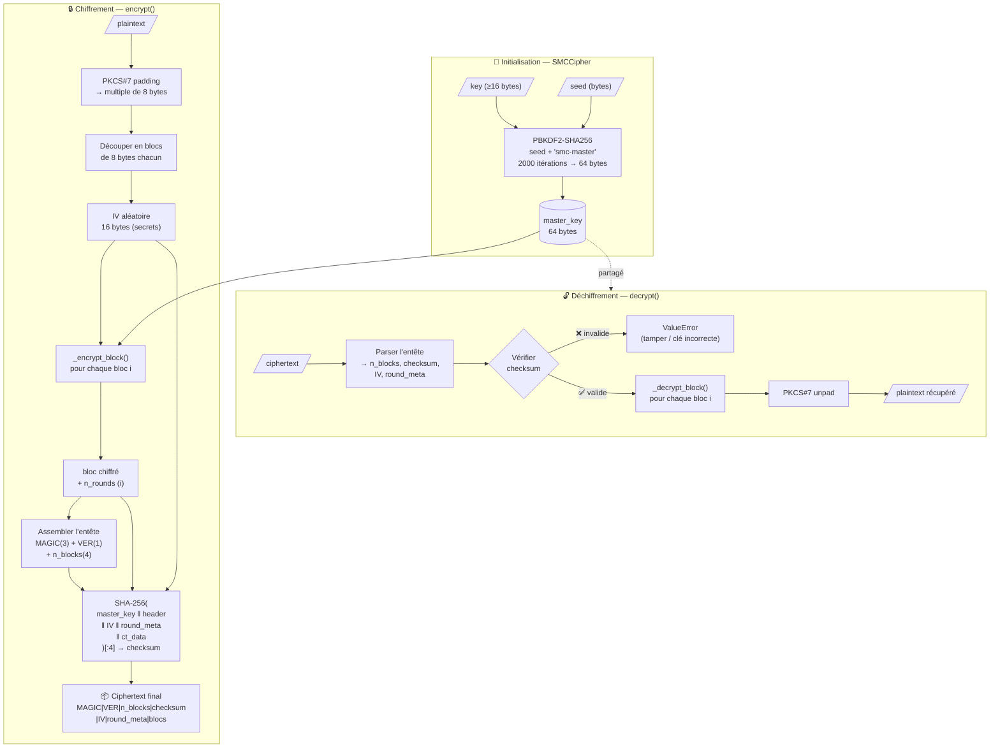
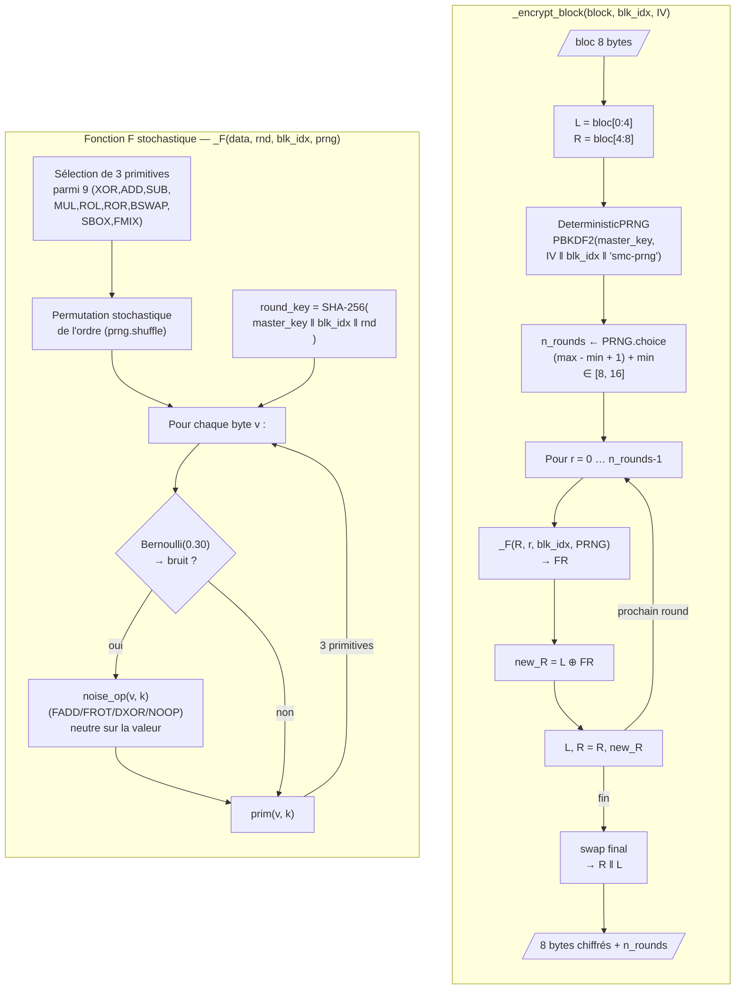
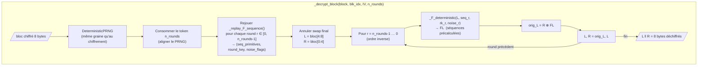
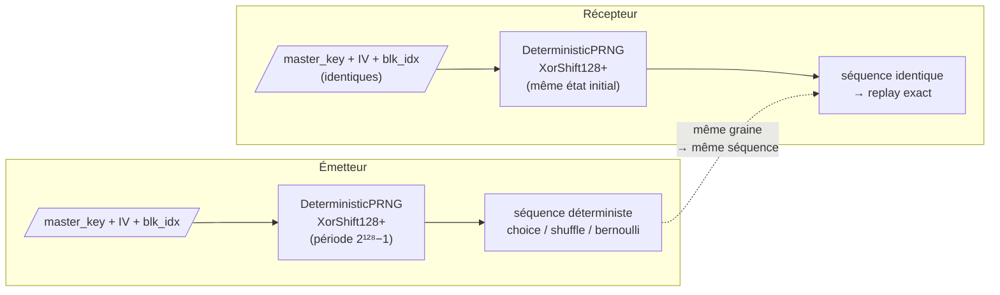
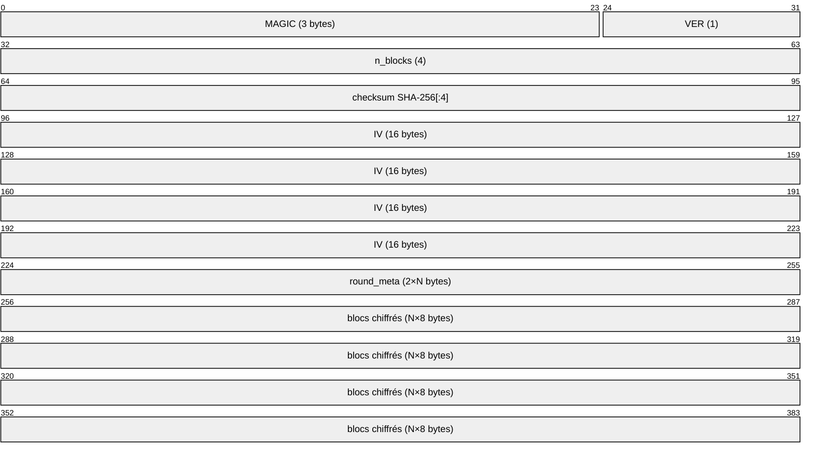

# Proteus-SMC — Diagramme de protocole

## Vue d'ensemble du cycle de vie

---

## Réseau de Feistel — chiffrement d'un bloc

---

## Déchiffrement d'un bloc — stratégie replay

---

## PRNG déterministe — synchronisation émetteur/récepteur

---

## Format du ciphertext

